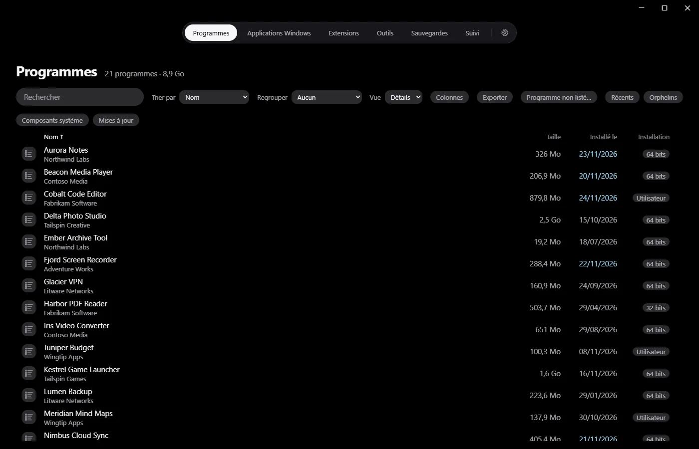

<div align="center">

# Uninstaller

**Désinstallez vraiment vos programmes Windows, et revenez en arrière si besoin.**

[English](README.md) · [Français](README.fr.md)




</div>

Uninstaller est une application de bureau pour Windows 10 et 11 qui retire les logiciels proprement. Elle lance le désinstalleur du programme, puis traque les dossiers, raccourcis, clés de registre, services et tâches planifiées qu'il a laissés derrière lui. Rien n'est effacé sur-le-champ : les restes partent en quarantaine, d'où vous pouvez tout restaurer.

Elle s'ouvre vite, ménage la mémoire et reste prudente avec votre système. On l'ouvre, on nettoie, on la ferme : elle ne tourne jamais en arrière-plan.

> La capture utilise des données de démonstration fictives. L'interface est actuellement en français.

## Points forts

- **Tout ce qui est installé, d'un coup d'œil.** Une liste unique et filtrable : programmes 64 et 32 bits, installations par utilisateur, autres comptes du PC. Tri, regroupement par éditeur, mois d'installation ou taille, vues Détails, Icônes et Liste, filtres sur les installations récentes et sur les entrées « orphelines » dont les fichiers ont disparu.
- **Ce que les désinstalleurs laissent, retrouvé.** Après une désinstallation, Uninstaller cherche les dossiers, raccourcis, clés de registre, services et tâches planifiées restants, et note chaque trouvaille Sûr, Modéré ou Avancé selon la force du lien avec le programme. Les éléments sûrs sont présélectionnés.
- **Presque tout est réversible.** Les éléments retirés vont en quarantaine, pas à la corbeille définitive. Les clés de registre sont d'abord sauvegardées en `.reg`, chaque lot est vérifié par empreinte, et l'écran Sauvegardes permet de restaurer ou de purger un lot. Les anciens lots sont purgés automatiquement après un délai que vous choisissez (7 à 90 jours).
- **Guidée, en quatre étapes.** Point de restauration, désinstalleur du programme, recherche des restes, nettoyage. Chaque action destructive annonce ce qui sera supprimé avant que vous confirmiez.
- **Plusieurs programmes d'un coup.** Sélectionnez un lot et retirez-le à la suite, avec un seul point de restauration, en mode silencieux quand l'installeur le permet (MSI, Inno Setup, NSIS).
- **Programmes récalcitrants ou déjà partis.** Forcez la désinstallation quand le désinstalleur est absent ou cassé, ou indiquez un programme qui n'apparaît plus dans la liste pour nettoyer ce qu'il en reste.
- **Prudente avec les droits.** L'application tourne en utilisateur normal. Les droits administrateur ne sont demandés que lorsqu'une action l'exige, via un petit assistant qui n'accepte qu'une liste fermée d'opérations. Les dossiers et clés vitaux du système sont protégés et refusés.

Également inclus : export ou impression de la liste des programmes (HTML, CSV ou texte) et navigation complète au clavier.

## Comment ça marche

1. **Choisissez un programme** dans la liste. Sélectionnez-en plusieurs pour les retirer en lot.
2. **Choisissez la profondeur** : Sûr, Modéré ou Avancé. Les niveaux plus profonds s'appuient sur des indices plus faibles et proposent plus de candidats.
3. **Uninstaller crée un point de restauration** (facultatif), puis lance le désinstalleur du programme et attend sa fin.
4. **Passez en revue les restes.** Une liste à cocher de fichiers et d'entrées de registre montre ce qui a été trouvé, les éléments de confiance élevée en gras, avec le nombre et la taille de votre sélection.
5. **Confirmez.** Les éléments choisis partent en quarantaine. Un bilan indique ce qui a été déplacé, ce qui demande les droits administrateur et ce qui a échoué. Vous pouvez restaurer le lot depuis l'écran Sauvegardes tant qu'il n'est pas purgé.

## Avancement

Uninstaller est en développement actif (version 0.1.0, pas encore de version packagée). Aujourd'hui : liste des programmes, désinstallation guidée, en lot et forcée, nettoyage des restes, quarantaine et écran Sauvegardes, export de la liste. Prévu ensuite : applications du Microsoft Store, extensions de navigateur, gestionnaire de démarrage, outils de nettoyage, suivi d'installation et mode ligne de commande. Voir la [feuille de route](ROADMAP.md).

## Démarrage

Pour l'instant, Uninstaller se compile depuis les sources. Il faut Windows 10 ou 11 (x64), Node.js 22+ et Rust 1.88+ avec les outils de build MSVC.

```bash
git clone https://github.com/QuentinPN/uninstaller.git
cd uninstaller
npm install
npm run tauri dev
```

`npm run tauri build` produit un installeur à la place. Le détail est dans le [guide développeur](docs/DEVELOPMENT.md).

## Construit avec


Un cœur Rust fait le travail système (registre, fichiers, processus) ; une interface Svelte par-dessus ne voit jamais de chemins bruts, seulement des identifiants opaques. Détails dans [`ARCHITECTURE.md`](ARCHITECTURE.md).

## Licence

[MIT](LICENSE) © 2026 Quentin Poullain

## Développeurs

Installation, commandes, documentation du projet et hooks git : [docs/DEVELOPMENT.md](docs/DEVELOPMENT.md).
