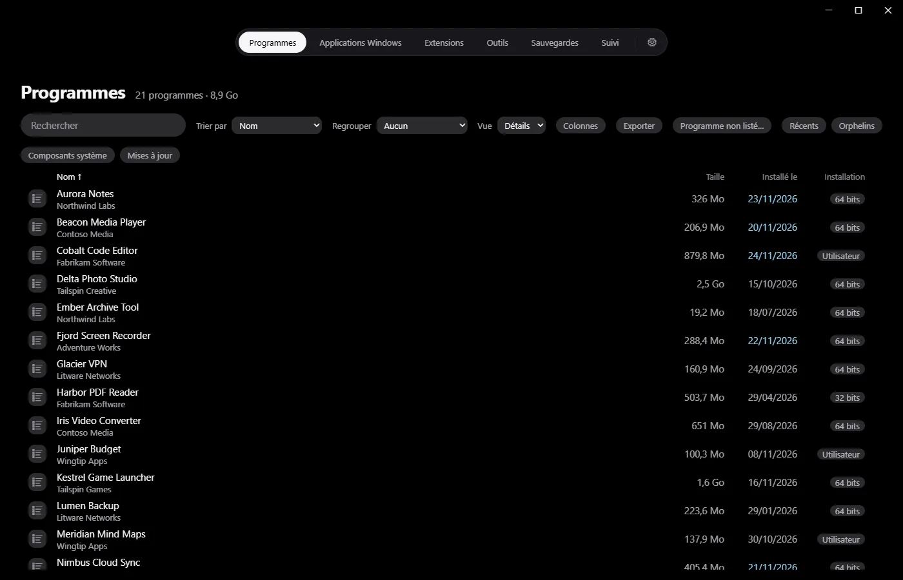

<div align="center">

# Uninstaller

**Remove Windows programs completely, and undo it if you change your mind.**

[English](README.md) · [Français](README.fr.md)




</div>

Uninstaller is a desktop app for Windows 10 and 11 that removes software properly. It runs the program's own uninstaller, then hunts down the folders, shortcuts, registry entries, services and scheduled tasks it left behind. Nothing is erased on the spot: leftovers go to a quarantine you can restore from.

It is built to be quick to open, light on memory, and careful with your system. Open it, clean up, close it: it never stays running in the background.

> The screenshot uses fictional demo data. The interface is currently in French.

## Highlights

- **See everything installed.** One searchable list of your programs: 64-bit and 32-bit, per-user installs, and other accounts on the PC. Sort, group by publisher, install month or size, switch between Details, Icons and List views, and filter recent installs or orphaned entries whose files are gone.
- **Find what uninstallers leave behind.** After a removal, Uninstaller scans for leftover folders, shortcuts, registry keys, services and scheduled tasks, and rates each find as Safe, Moderate or Advanced depending on how strongly it belongs to the program. The safe ones are preselected.
- **Undo almost anything.** Removed items are moved to a quarantine, not deleted. Registry keys are saved to `.reg` files first, each batch is integrity-checked, and a Backups screen lets you restore or purge a batch. Old batches are purged automatically after a delay you choose (7 to 90 days).
- **Guided, in four steps.** Restore point, the program's own uninstaller, leftover scan, cleanup. Every destructive action shows what will be removed before you confirm.
- **Several programs at once.** Select a batch and remove them one after another with a single restore point, in silent mode when the installer supports it (MSI, Inno Setup, NSIS).
- **Stubborn or already-gone programs.** Force an uninstall when the uninstaller is missing or broken, or name a program that no longer appears in the list and clean up what remains.
- **Careful with privileges.** The app runs as a normal user. Administrator rights are requested only when an action needs them, through a small helper that accepts nothing but a fixed list of operations. System-critical folders and registry keys are protected and refused.

Also included: export or print the program list (HTML, CSV or text), and full keyboard navigation.

## How it works

1. **Pick a program** from the list. Select several to remove them in one batch.
2. **Choose how deep to go**: Safe, Moderate or Advanced. Deeper levels look at weaker clues and show more candidates.
3. **Uninstaller creates a restore point** (optional), then launches the program's own uninstaller and waits for it to finish.
4. **Review the leftovers.** A checklist of files and registry entries shows what was found, with the high-confidence items in bold and a running count and size of what you selected.
5. **Confirm.** The selected items move to quarantine. A summary tells you what was moved, what needs administrator rights, and what failed. You can restore the batch from the Backups screen at any time before it is purged.

## Status

Uninstaller is in active development (version 0.1.0, no packaged release yet). Today it covers the program list, guided, batch and forced uninstalls, leftover cleanup, the quarantine and the Backups screen, and list export. Planned next: Windows Store apps, browser extensions, a startup manager, cleaning tools, install tracking and a command-line mode. See the [roadmap](ROADMAP.md).

## Getting started

Uninstaller is built from source for now. You need Windows 10 or 11 (x64), Node.js 22+ and Rust 1.88+ with the MSVC build tools.

```bash
git clone https://github.com/QuentinPN/uninstaller.git
cd uninstaller
npm install
npm run tauri dev
```

`npm run tauri build` produces an installer instead. Full instructions are in the [developer guide](docs/DEVELOPMENT.md).

## Built with


A Rust core does the system work (registry, files, processes); a Svelte interface sits on top and never sees raw paths, only opaque identifiers. Details in [`ARCHITECTURE.md`](ARCHITECTURE.md).

## License

[MIT](LICENSE) © 2026 Quentin Poullain

## Developers

Setup, commands, project documentation and git hooks: [docs/DEVELOPMENT.md](docs/DEVELOPMENT.md).
